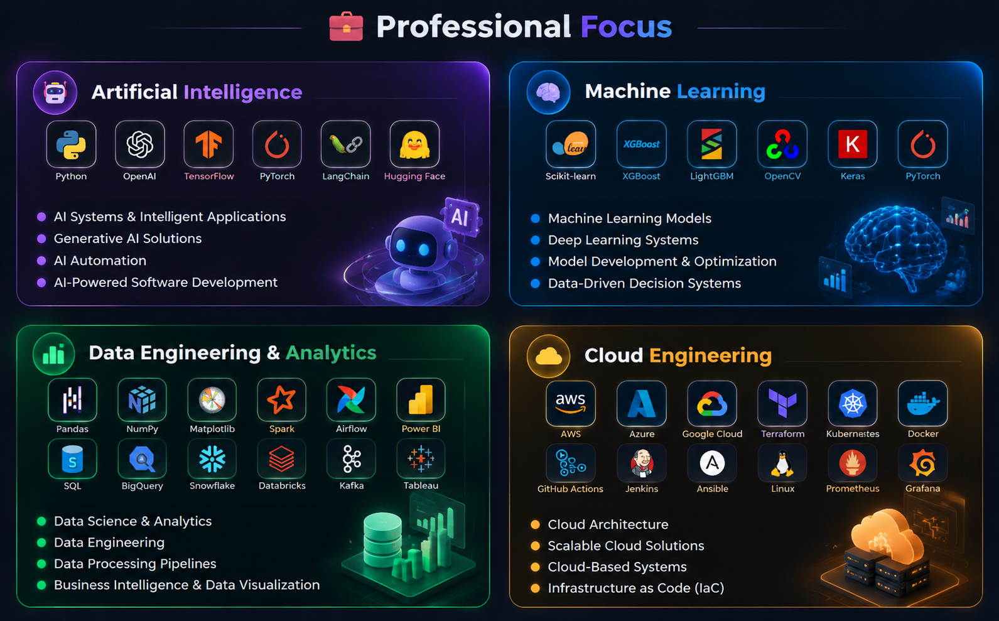

  

  

<h2 align="center">🧬 About Me</h2>

<table width="100%">
<tr>
<td align="center">
<h3>👨‍💻 Rana Hamza &nbsp;|&nbsp; Software Engineer</h3>
<b>I build data-driven and intelligent solutions that turn complex problems into practical, scalable and measurable outcomes.</b>  
My work combines <b>AI, Machine Learning, Data Engineering, Data Science, Analytics and Cloud Technologies</b> to solve real-world business and technical challenges. I focus on understanding the problem, choosing the right approach and using technology to create meaningful value. 
</td>
</tr>
</table>

<h2 align="center">🎯 What I Can Do</h2>

<table width="100%">
<tr>
<td width="33%" valign="top" align="center">
<h3>📈 Data to Insights</h3>
Transform raw data into meaningful insights for better decisions
</td>
<td width="33%" valign="top" align="center">
<h3>🗄️ Databases &amp; Pipelines</h3>
SQL solutions, ETL/ELT workflows and data pipelines
</td>
<td width="34%" valign="top" align="center">
<h3>🧠 ML Solutions</h3>
Prediction, classification, recommendation and automation
</td>
</tr>
<tr>
<td  valign="top" align="center">
<h3>🤖 AI Applications</h3>
AI-powered applications and intelligent workflows
</td>
<td  valign="top" align="center">
<h3>📊 BI Dashboards</h3>
BI dashboards and analytical solutions
</td>
<td  valign="top" align="center">
<h3>⚡ Automation</h3>
Automate repetitive tasks and improve inefficient processes
</td>
</tr>
<tr>
<td colspan="3" valign="top" align="center">
<h3>☁️ End-to-End Solutions</h3>
Connect Data, AI, Analytics and Cloud into complete, end-to-end solutions
</td>
</tr>
</table>

<h2 align="center">🧩 How I Solve Problems</h2>

<table width="100%">
<tr>
<td width="25%" valign="top" align="center">
<h3>🔍 1. Understand</h3>
Root cause, requirements, constraints and the expected outcome
</td>
<td width="25%" valign="top" align="center">
<h3>🧱 2. Break Down</h3>
Split complex challenges into manageable parts
</td>
<td width="25%" valign="top" align="center">
<h3>⚖️ 3. Evaluate</h3>
Choose by accuracy, efficiency, reliability, scalability and business impact
</td>
<td width="25%" valign="top" align="center">
<h3>✅ 4. Validate &amp; Optimize</h3>
Test, troubleshoot, optimize and refine until it delivers
</td>
</tr>
</table>

<i>A solution isn't complete just because it works. It's complete when it delivers the required outcome.</i>

<h2 align="center">🏢 What I Bring to an Organization</h2>

I contribute beyond assigned tasks by turning **data into decisions**, **manual work into automation** and **business challenges into technology-driven solutions**.

<h2 align="center">🚀 What I Can Build</h2>

<h2 align="center">🎯 Mindset &amp; Goal</h2>

> 💡 Strong engineering is not measured by how many technologies are used, but by the **quality of the solution** and the **impact it creates**.

My goal is to use **AI, Data and Cloud** technologies to solve meaningful problems, improve decision-making, automate inefficient processes, increase productivity and contribute to organizational and client success.

<b>I want my work to be measured by the problems I solve, the quality I deliver and the value I create.</b>

  

<h2 align="center">🎓 Education &amp; Certifications</h2>

<table width="100%">
<tr>
<td width="33%" align="center" valign="top"><h3>🎓 Education</h3></td>
<td width="33%" align="center" valign="top"><h3>🏆 Certification</h3></td>
<td width="34%" align="center" valign="top"><h3>☁️ Certification</h3></td>
</tr>
</table>

<h2 align="center">🛠️ Technology Stack</h2>

<table width="100%">
<tr>
<td width="50%" align="center" valign="top">

<h3>💻 Programming Languages</h3>

  

</td>
<td width="50%" align="center" valign="top">

<h3>🎨 Frontend</h3>

  

</td>
</tr>

<tr>
<td width="50%" align="center" valign="top">

<h3>✨ Generative AI &amp; LLMs</h3>

  

</td>
<td width="50%" align="center" valign="top">

<h3>🗄️ Databases</h3>

  

</td>
</tr>

<tr>
<td width="50%" align="center" valign="top">

<h3>🧩 Backend &amp; APIs</h3>

  

</td>
<td width="50%" align="center" valign="top">

<h3>🚀 DevOps &amp; CI/CD</h3>

  

</td>
</tr>

<tr>
<td colspan="2" width="100%" align="center" valign="top">

<h3>🔧 Developer Tools</h3>

  

  

<b>Version Control · Code Editors · API Testing · Development Environment</b>

</td>
</tr>
</table>

<h3>⚙️ Engineering Practices</h3>

 

  

</td>
</tr>
</table>

<h3>⚙️ Engineering Practices</h3>
 
</td>
</tr>
<tr><td colspan="2"></td></tr>
</table>

<h2 align="center">📊 GitHub Analytics</h2>

<h2 align="center">🌌 Contribution Matrix</h2>

<h2 align="center">🤝 Let's Connect</h2>

 

  

